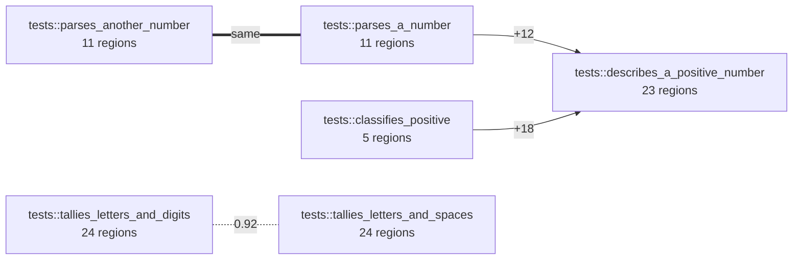
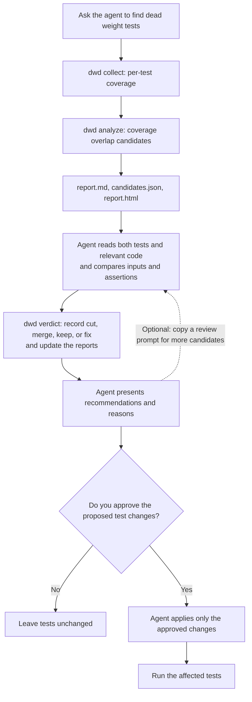

# dead-weight-tests

[](https://skills.sh/roberts-pumpurs/dead-weight-tests)
[](https://github.com/roberts-pumpurs/dead-weight-tests/actions/workflows/ci.yml)

An agent skill and a CLI, `dwd`, that find Rust tests which add no coverage of their own: tests that run exactly the same code as another test, tests whose code is a strict subset of another test's, and near-identical pairs. LLM-written test suites collect these fast.

Coverage only finds suspects. Two tests can run the same lines and check different things, so the skill makes the agent read both tests before it recommends a cut.

## Install

```sh
npx skills add roberts-pumpurs/dead-weight-tests
```

Then ask your agent to "find dead weight tests". On the first run it installs `dwd` and the cargo tools `dwd` drives, checks your setup with `dwd doctor`, and fixes what is missing. You need Rust from [rustup](https://rustup.rs). The first run compiles `dwd` from source, so it takes a few minutes longer.

<details>
<summary>Manual install</summary>

```sh
cargo install --locked cargo-nextest cargo-llvm-cov
cargo install --locked --git https://github.com/roberts-pumpurs/dead-weight-tests --tag v0.3.0 dead-weight-tests # x-release-please-version
rustup component add llvm-tools-preview   # inside your workspace, for its toolchain
```

The `dwd` tag matches the skill's version. The skill checks this and reinstalls `dwd` when they differ.

</details>

## What you get

On this repo's [`fixture/`](fixture/src/lib.rs) crate, `dwd collect` and `dwd analyze` produce a containment graph:



and one entry per candidate, in review order (excerpt from `report.md`):

```markdown
### 1. duplicate (same file): `dwd-fixture tests::parses_another_number`

- Tier: unit. Location: fixture/src/lib.rs:85
- Keeper: `dwd-fixture tests::parses_a_number` (unit, fixture/src/lib.rs:79)
- Reason: executes exactly the same 11 regions as the keeper. Group size: 2.
```

`report.html` holds the same data as an interactive page: a module treemap, the containment graph, the two tests of a pair side by side with source lines colored by which test runs them, and per-line test counts.

## What the agent does

Ask your agent to "find dead weight tests". It follows [`SKILL.md`](skills/dead-weight-tests/SKILL.md):

1. Sets up: installs or updates `dwd`, runs `dwd doctor`, and applies the fixes it names.
2. Collects per-test coverage and analyzes it with `dwd`.
3. Takes the next batch of unreviewed candidates from `dwd pending`, same-file pairs first, and compares each test's assertions with the other test's.
4. Records a cut, merge, keep, or fix verdict for each, with a one-sentence reason. A fix means the test's name promises a check its body never makes.
5. Shows you a table of recommended cuts, the coverage those cuts lose together, the fix list, the tests to keep, a link to the report page, and the one next action with the most value. It changes tests only after you approve the list.

To have more candidates judged, use the report page: its **Copy review prompt** button copies a prompt for one candidate or for the filtered table. Paste it into an agent, which reviews those candidates and records the verdicts.

## Will it work on your repo?

It works on a Cargo workspace whose tests run under [cargo-nextest](https://nexte.st), on Linux or macOS. It needs [cargo-llvm-cov](https://github.com/taiki-e/cargo-llvm-cov) and the `llvm-tools-preview` component of the toolchain the workspace uses. A project that builds only inside a dev shell runs `dwd` there. `dwd doctor` checks all of this and names each fix.

Out of reach: doctests, tests for non-host targets (wasm, cross builds), and coverage of child processes started with `env_clear()`. Each case of a parametrized test (rstest, test-case) points at its parametrized function. Other macro-generated tests get no source location, so the agent finds them by name. The full list is in [Limits](skills/dead-weight-tests/SKILL.md#limits).

## How it works



1. `dwd collect` turns on coverage instrumentation and runs nextest with `dwd` as the target runner. Nextest runs every test in its own process, and the runner gives each process its own profile directory. Subprocesses a test starts write to the same directory.
2. When the tests finish, `dwd collect` sorts each test's profiles into passed, failed, killed, no profile, or never reached. It exports the covered LLVM regions of each passing test and lists the rest with their reason in `skipped.json`.
3. `dwd analyze` drops test code (every test runs its own body), groups regions that the same tests cover, finds duplicate, subsumed, and near-duplicate tests in review order, and prints a status summary.
4. `dwd pending` lists the candidates that have no verdict yet.
5. `dwd verdict` checks each verdict row against the analysis, appends the valid rows to `verdicts.jsonl`, and re-renders the reports. It also reports the regions that no test would run after every cut and merge, so two cuts that depend on each other show up before you delete anything.

Artifacts go to `$XDG_STATE_HOME/dwd/<workspace name>-<hash>/` (`~/.local/state/dwd/...` when `XDG_STATE_HOME` is unset), so verdicts survive reboots. Pass `--dir DIR` or set `DWD_DIR` to put them elsewhere. Instrumented builds go to `target/dwd/`, apart from normal builds, so a second `dwd collect` rebuilds only what changed.

## Usage without an agent

```sh
cd your-workspace
dwd doctor               # names the fix for anything missing
dwd collect -- --workspace
dwd analyze
open "$(dwd path report)"
```

`dwd --help` lists every command and flag.

## Development

See [CONTRIBUTING.md](CONTRIBUTING.md).

## License

MIT
