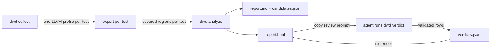

# dead-weight-tests

[](https://skills.sh/roberts-pumpurs/dead-weight-tests)
[](https://github.com/roberts-pumpurs/dead-weight-tests/actions/workflows/ci.yml)

An agent skill that finds Rust tests which add no coverage of their own: tests that run exactly the same code as another test, tests whose code is a strict subset of another test's, and near-identical pairs. LLM-written test suites collect these fast.

Coverage only finds suspects. Two tests can run the same lines and check different things, so the skill makes the agent read both tests before it recommends a cut.

## Install

```sh
npx skills add roberts-pumpurs/dead-weight-tests
```

Then ask your agent to "find dead weight tests". It follows [`SKILL.md`](skills/dead-weight-tests/SKILL.md).

Install the `dwd` binary the skill runs:

```sh
cargo install --locked --git https://github.com/roberts-pumpurs/dead-weight-tests dead-weight-tests
```

Requirements in the target project: [`cargo-nextest`](https://nexte.st), [`cargo-llvm-cov`](https://github.com/taiki-e/cargo-llvm-cov), and the `llvm-tools-preview` rustup component. Unix only.

## How it works



1. `dwd collect` turns on coverage instrumentation and runs nextest with `dwd` as the target runner. Nextest runs every test in its own process, and the runner gives each process its own profile directory. Subprocesses a test starts write to the same directory.
2. When the tests finish, `dwd collect` sorts each test's profiles into passed, failed, killed, no profile, or never reached. It merges and exports the covered LLVM regions of each passing test, and lists the rest with their reason in `skipped.json`.
3. `dwd analyze` drops test code (every test runs its own body), groups regions that the same tests cover, and finds duplicate, subsumed, and near-duplicate tests in review rank order. It writes a markdown report, a JSON candidate list, and a self-contained HTML report.
4. The HTML report shows a module treemap, a containment graph, the two tests of a pair side by side with source lines colored by which test runs them, and per-line test counts. Its "Copy review prompt" button hands chosen candidates to an agent, which records cut, merge, keep, or fix verdicts through `dwd verdict`. `dwd verdict` checks each pair against the analysis, appends valid rows to `verdicts.jsonl`, and re-renders the reports. A fix verdict means the test's name promises a check its body never makes.

Artifacts go to `<OS temp dir>/dwd/<workspace name>-<hash>/`. The OS removes them when it cleans its temp dir, verdicts included. Pass `--dir DIR` or set `DWD_DIR` to keep them.

## Usage without an agent

```sh
cd your-workspace
dwd collect -- --workspace
dwd analyze
open "$(dwd path report)"
```

`dwd --help` lists every command and flag.

## Development

`flake.nix` has a dev shell with everything the end-to-end test needs: the toolchain from `rust-toolchain.toml` (with `llvm-tools-preview`), `cargo-nextest`, and `cargo-llvm-cov`. With direnv, run `direnv allow` once; otherwise use `nix develop`.

```sh
cargo test --workspace
cargo clippy --workspace --all-targets -- -D warnings
cargo fmt --all --check
cargo test --test fixture_e2e -- --ignored   # end to end, inside the dev shell
```

`fixture/` is the `dwd-fixture` workspace member, a small crate with planted dead weight: a duplicate, a subsumed test, a near-duplicate pair, a test that reaches the library only through a subprocess, a test that fails on request, and a test that runs only test code. The table at the top of `fixture/src/lib.rs` lists them. The end-to-end test runs `dwd collect`, `analyze`, and `verdict` against it in a temporary target dir, checks that each planted case shows up, and checks that a normal build afterwards is not instrumented.

Releases use [release-please](https://github.com/googleapis/release-please) and Conventional Commits. Merging the release PR bumps the `dead-weight-tests` version in `Cargo.toml`, `Cargo.lock`, and `SKILL.md` (not `dwd-fixture`), tags the version, attaches a skill archive to the GitHub release, and smoke-tests the release: it installs the skill with the skills CLI and `dwd` from the tag. skills.sh has no upload step: it lists public repositories from that install telemetry.

Branch rules for `main` live in [`.github/rulesets/main.json`](.github/rulesets/main.json): squash-merged PRs only, both CI jobs green, signed commits, no force pushes or deletion; repository admins can bypass. After a change to that file merges, apply it with an admin `gh` login: `.github/rulesets/apply.sh`. A required check that the file renames blocks every PR until you do.

The release PR comes from the Actions token, and PRs from that token start no workflows. So the Release workflow dispatches CI on the release PR branch, and the required checks run on it like on any other PR.

## License

MIT
