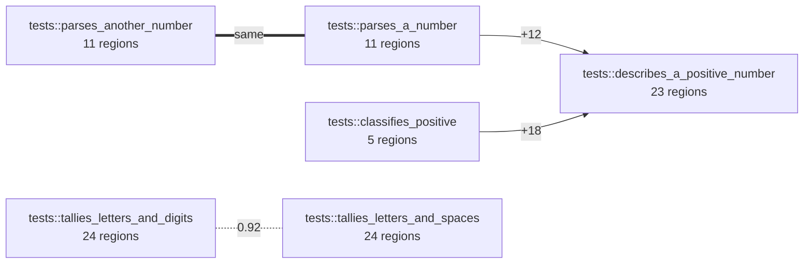
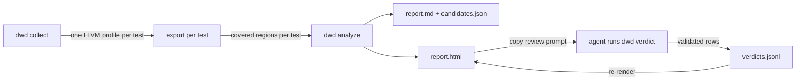

# dead-weight-tests

[](https://skills.sh/roberts-pumpurs/dead-weight-tests)
[](https://github.com/roberts-pumpurs/dead-weight-tests/actions/workflows/ci.yml)

An agent skill and a CLI, `dwd`, that find Rust tests which add no coverage of their own: tests that run exactly the same code as another test, tests whose code is a strict subset of another test's, and near-identical pairs. LLM-written test suites collect these fast.

Coverage only finds suspects. Two tests can run the same lines and check different things, so the skill makes the agent read both tests before it recommends a cut.

## What you get

On this repo's [`fixture/`](fixture/src/lib.rs) crate, `dwd collect` and `dwd analyze` produce a containment graph:



and one entry per candidate, in review order (excerpt from `report.md`):

```markdown
### 1. duplicate (same file): `dwd-fixture tests::parses_another_number`

- Tier: unit. Location: fixture/src/lib.rs:85
- Keeper: `dwd-fixture tests::parses_a_number` (unit, fixture/src/lib.rs:79)
- Reason: executes exactly the same 11 regions as the keeper. Group size: 2.
```

`report.html` holds the same data as an interactive page: a module treemap, the containment graph, the two tests of a pair side by side with source lines colored by which test runs them, and per-line test counts.

## Install

```sh
npx skills add roberts-pumpurs/dead-weight-tests
cargo install --locked --git https://github.com/roberts-pumpurs/dead-weight-tests dead-weight-tests
```

The first command installs the skill; the second installs `dwd`, which the skill runs.

## What the agent does

Ask your agent to "find dead weight tests". It follows [`SKILL.md`](skills/dead-weight-tests/SKILL.md):

1. Collects per-test coverage and analyzes it with `dwd`.
2. Reviews every same-file candidate, then more in rank order up to 20, comparing each test's assertions with the other test's.
3. Records a cut, merge, keep, or fix verdict for each, with a one-sentence reason. A fix means the test's name promises a check its body never makes.
4. Shows you a table of recommended cuts, the fix list, and the tests to keep. It changes tests only after you approve the list.

To have more candidates judged, use the report page: its **Copy review prompt** button copies a prompt for one candidate or for the filtered table. Paste it into an agent, which reviews those candidates and records the verdicts.

## Will it work on your repo?

It works on a Cargo workspace whose tests run under [cargo-nextest](https://nexte.st), on Linux or macOS. It needs [cargo-llvm-cov](https://github.com/taiki-e/cargo-llvm-cov) and the `llvm-tools-preview` component of the toolchain the workspace uses. A project that builds only inside a dev shell runs `dwd` there.

Out of reach: doctests, tests for non-host targets (wasm, cross builds), and coverage of child processes started with `env_clear()`. Tests generated by macros (rstest, test-case) get no source location, so the agent finds them by name. The full list is in [Limits](skills/dead-weight-tests/SKILL.md#limits).

## How it works



1. `dwd collect` turns on coverage instrumentation and runs nextest with `dwd` as the target runner. Nextest runs every test in its own process, and the runner gives each process its own profile directory. Subprocesses a test starts write to the same directory.
2. When the tests finish, `dwd collect` sorts each test's profiles into passed, failed, killed, no profile, or never reached. It exports the covered LLVM regions of each passing test and lists the rest with their reason in `skipped.json`.
3. `dwd analyze` drops test code (every test runs its own body), groups regions that the same tests cover, and finds duplicate, subsumed, and near-duplicate tests in review order.
4. `dwd verdict` checks each verdict row against the analysis, appends the valid rows to `verdicts.jsonl`, and re-renders the reports.

Artifacts go to `<OS temp dir>/dwd/<workspace name>-<hash>/`. The OS deletes them when it cleans its temp dir, verdicts included. Pass `--dir DIR` or set `DWD_DIR` to keep them.

## Usage without an agent

```sh
cd your-workspace
dwd collect -- --workspace
dwd analyze
open "$(dwd path report)"
```

`dwd --help` lists every command and flag.

## Development

See [CONTRIBUTING.md](CONTRIBUTING.md).

## License

MIT
